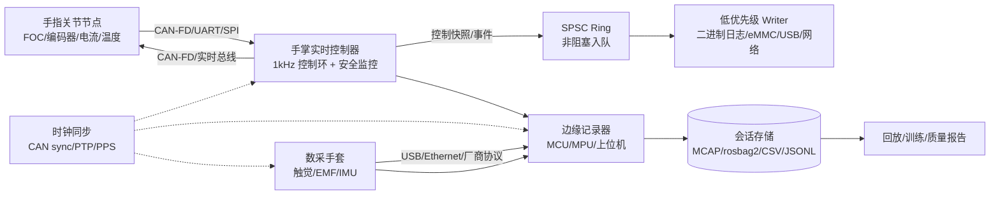

# 01 · 核心问题回答：灵巧手嵌入式系统如何同时执行操作与完整记录过程

> 核心问题：如何设计灵巧手嵌入式系统，为 Physical AI 提供既能执行真实世界操作、又能把操作过程完整记录下来的能力？
>
> 本文是设计讨论稿，不是生产方案，重点记录问题拆解、架构取舍、可运行验证以及对未知边界的诚实标注。

## 1. 我对问题的理解

这个问题的关键词不是“做一个日志功能”，而是同时满足两个不同 QoS 的系统目标：

1. **执行真实世界操作**：控制链路必须实时、确定、安全。传感器读取、关节控制、电机驱动、限位/过流/通信超时保护不能被数据记录、文件系统或上位机上传阻塞。
2. **完整记录操作过程**：Physical AI 需要的不只是最终动作结果，而是“指令—本体状态—接触感知—事件—时间同步—固件/标定版本”的可回放数据流。记录结果要能判断是否完整、哪里缺失、时间是否对齐、数据是否被破坏。

因此系统不能做成一个大循环：

```text
读传感器 → 控制电机 → 写文件/发网络 → 再进入下一周期
```

一旦写 eMMC、USB 或网络发生抖动，控制周期就会被拖慢，极端情况下可能造成抓持失败、关节振荡或安全保护误触发。

更合理的设计是：**强实时控制面 + 异步可校验数据面 + 统一会话/时间/模式层**。



## 2. 设计目标与非目标

### 2.1 目标

| 维度 | 设计目标 | 验证方式 |
|---|---|---|
| 控制确定性 | 固定周期执行；控制路径无 malloc、无阻塞写、无不确定重试 | WCET 测量、GPIO+示波器、最坏分支覆盖 |
| 操作安全 | 指令超时、关节限位、过流、过温、传感器失效、deadline miss 可诊断并进入安全输出 | 故障注入与安全状态机测试 |
| 数据完整 | 每帧有序号、时间戳、CRC；控制样本有周期号；缺失可检测 | 解码器严格校验、掉电/拔线/慢盘实验 |
| 时间一致 | 手、手套、触觉、IMU、事件使用同一时钟模型，支持对齐与漂移修正 | 同步脉冲/总线 sync 偏差测量 |
| 可回放 | 记录单位、坐标系、Schema、固件/标定版本、会话元数据齐全 | 离线解码、CSV/JSONL/MCAP 导出、回放测试 |
| 低耦合移植 | 核心逻辑不绑定具体 MCU、总线和文件系统；硬件通过回调注入 | Host GCC 编译 + MCU port 层适配 |
| 可演进 | 协议带版本号，新增传感器通道不破坏旧日志解析 | 协议编解码单测、向后兼容测试 |

### 2.2 非目标（这个探索仓库不声称完成）

- 不实现真实 FOC、双编码器驱动、CAN-FD 协议栈或触觉阵列驱动；
- 不提供功能安全认证结论，不把参考代码当作 ASIL/SIL 产品实现；
- 不声称主机仿真的 6 µs 耗时等于 MCU WCET；
- 不替代硬件原理图、信号完整性、热设计、EMC、寿命和跌落验证；
- 不假设所有数据都能零丢失。系统要做到的是：**正常负载不丢；异常过载/掉电/断链时不静默丢失，能显式报告缺口并进入预定义降级策略。**

## 3. 需求规模与约束（公开信息 + 工程假设）

### 3.1 公开产品背景

舞肌官网公开信息显示：

- Wuji Hand：20 个主动自由度，每指 4 个关节，FOC 矢量控制、双编码器反馈、USB 2.0、重复定位精度 ±1 mm。
- Wuji Glove：526 个有效触觉点、120 FPS；5 个指尖 6DOF EMF 模块；手背 6 轴 IMU 800 Hz；RJ45 100BASE-TX；官方生态包含 CLI/Python SDK。

这些数据说明系统同时存在：

- **高频控制数据**：多关节目标、位置、速度、电流、PWM、错误码；
- **中频感知数据**：触觉阵列、EMF、关节触觉/接近觉；
- **高频惯性数据**：IMU；
- **低频但重要的事件/元数据**：模式切换、保护、标定、固件版本、会话开始/结束、时间同步状态。

### 3.2 原型假设（均为工程假设，非已知内部实现）

- 手掌控制器以 1 kHz 周期运行 20 关节状态汇总与上层指令跟踪；各手指内部 FOC 环可以更高，例如 10–20 kHz，由关节 MCU 本地完成。
- 手内总线候选为 CAN-FD 或厂商实时串行总线；最终选择取决于引脚、线束长度、带宽、延迟、成本和现有电机模组接口。
- 手掌控制器旁放置边缘记录器（MPU/SoC/上位机），MCU 负责强实时控制，MPU 负责文件系统、网络、MCAP/rosbag2、压缩和上传。若成本/体积要求单 MCU，也应把记录 writer 放到低优先级任务和外部存储，而不是放进控制 ISR。
- 记录格式先使用轻量二进制帧，便于 MCU 落地；到边缘侧再转换为 MCAP/rosbag2/Protobuf/CDR，兼容 Physical AI 数据管线。

### 3.3 粗略带宽感

本仓库的 20 关节控制样本编码后约 446 B/帧：

- 1 kHz 原始带宽约 **446 KB/s（3.57 Mbps）**，对 CAN-FD 单总线已不轻松，因此手内实时总线不应无脑上传全部高频调试字段；应区分控制环必需 PDO 与记录/诊断数据。
- 手套侧仅按原始数值粗算：526×120×2 B 触觉 + 5×6×4×120 B EMF + 6×2×800 B IMU ≈ **146.7 KB/s（1.20 Mbps）**，100BASE-TX 或 USB 2.0 带宽充足，但真正的难点是时间同步、抖动、丢包重传和数据对齐。
- 若加入多指触觉阵列、关节高分辨率编码器、麦克风或视频，带宽和存储会快速上升，需要分级采样、增量编码、压缩和独立数据通道。

## 4. 总体架构：三个平面

### 4.1 实时控制面

职责：

1. 周期触发：硬件定时器或确定优先级的控制任务；
2. 读取关节状态：编码器、电流、温度、触觉/接近觉、总线状态；
3. 安全检查：指令超时、位置/速度/电流/温度限制、传感器有效性、通信 CRC、deadline；
4. 控制计算：关节目标插值、位置/速度/力矩控制、前馈、限幅；
5. 输出指令：FOC 电流/电压/PWM 或电机模组目标；
6. 生成本周期记录快照并**非阻塞**入队。

设计原则：

- 控制路径不调用阻塞文件 I/O、网络发送、动态内存和无界重试；
- ISR 只做必须硬件响应的动作，重计算和协议解析放到中断下半部/高优先级任务；
- 关键参数上电从 Flash/EEPROM 加载到 RAM，运行期避免慢速存储访问；
- 所有循环次数和数据长度静态可确定，便于 WCET 分析；
- 安全输出不依赖记录系统是否健康。

### 4.2 数据记录面

职责：

1. 接收控制面快照和传感器数据流；
2. 编码为带帧头、序号、时间戳、长度、CRC 的二进制帧；
3. 通过 SPSC ring / 无锁队列解耦生产和消费速度；
4. 低优先级 writer 写本地文件、eMMC、SD、USB 或网络；
5. 维护会话 manifest、数据文件 CRC、Schema、标定/固件版本和上传状态；
6. 离线解码器生成完整性报告并导出训练/回放格式。

关键机制：

- **背压策略**：队列满时控制线程不等待，按数据优先级丢弃或降级低价值调试帧；控制周期号、安全事件和故障码应优先保留。
- **显式 GAP**：发生丢弃后，在队列恢复时写入 GAP marker，记录累计丢帧数和关联周期；离线工具必须能让使用者看到缺口。
- **批量写与 WAL**：writer 批量落盘，使用 append-only 数据块 + WAL/manifest；会话正常结束才提交完整清单。
- **断电恢复**：先写数据块和 CRC，再写 manifest/成功标志；重启后发现未提交会话，标记为“未正常结束”，而不是当作完整数据集。
- **时间对齐**：每帧同时保存设备时间和主机时间；同步报文记录偏移、漂移和同步质量。

### 4.3 会话与模式层

一次操作采集会话应包含：

- 会话 ID、设备序列号、左右手、硬件版本、固件版本、协议/Schema 版本；
- 关节构型、传感器通道、单位、坐标系、标定参数版本；
- 手套/手/相机/上位机时钟同步状态；
- 操作者、任务标签、遥操作/自主模式、控制频率、记录频率；
- 开始/结束事件、模式切换、安全故障、固件升级记录；
- 数据文件列表、大小、SHA-256/CRC、帧数、起止周期、缺失区间和质量报告。

这层直接服务 Physical AI：训练侧不仅要知道“发生了什么动作”，还要知道数据来自哪一版硬件/固件、是否丢帧、是否处于故障或保护状态。

## 5. 端到端数据流

### 5.1 会话开始

1. 发现灵巧手、手套、记录器和上位机，读取设备版本与能力；
2. 加载对应 Schema、标定参数、关节限位和安全参数；
3. 建立时钟同步：记录初始 offset/drift、同步源和误差；
4. 创建会话目录、二进制数据文件、WAL/manifest；
5. 写入 `session_metadata` 帧和开始事件；
6. 控制环进入使能前自检：通信、编码器、电流采样、温度、存储可写、记录队列可用；
7. 自检通过后进入位置/力矩控制或遥操作映射模式。

### 5.2 运行中

每个控制周期：

```text
timer tick
  → 读取关节/传感器快照
  → 总线 CRC/超时/有效性检查
  → 安全监控评估
  → 控制算法与限幅
  → 下发关节指令
  → 计算周期耗时/deadline
  → 编码控制快照
  → SPSC ring 非阻塞入队
  → 低优先级 writer 批量落盘/发送
```

手套和外部传感器可以由独立采集任务进入同一记录服务，使用统一 `session_id + timestamp + source_id`。

### 5.3 异常与降级

| 异常 | 控制面行为 | 记录面行为 |
|---|---|---|
| 记录队列满 | 不阻塞控制；丢弃低优先级帧或最新调试快照 | 增加 dropped 计数，恢复后写 GAP |
| 写盘/网络慢 | 控制环继续运行 | ring 水位告警；按优先级降级；必要时停止高频调试通道 |
| 传感器 CRC 错 | 本帧数据判无效，不做无界 while 重试；连续错误进安全策略 | 记录通信错误事件和错误码 |
| 控制指令超时 | 保持/零力/安全位置，具体策略取决于关节是否自锁与负载 | 记录超时故障、模式切换和最后目标 |
| 过流/过温/越限 | 限流、卸力或进入安全保持，故障锁存需明确恢复条件 | 高优先级事件帧落盘并标记会话质量 |
| 掉电 | 硬件保护、制动/自锁策略按执行器特性设计 | 未写 manifest 的会话标记为未提交；重启做 CRC 扫描 |
| 时钟失步 | 控制环使用本地单调时钟，不依赖主机时间 | 降低数据对齐质量标记，记录 sync lost 事件 |

### 5.4 会话结束与上传

1. 停止控制指令并进入安全状态；
2. flush ring 和文件缓冲区；
3. 写结束事件、帧数、起止周期、丢帧/GAP、故障统计；
4. 计算文件 CRC/哈希并原子替换 manifest；
5. 上传到数据平台，支持断点续传、去重和校验；
6. 离线工具生成质量报告：完整率、丢帧率、CRC 错误、时间同步误差、deadline miss、安全事件。

## 6. 关键技术选型与取舍

### 6.1 为什么控制环和记录环用队列解耦

控制周期的 deadline 是硬约束，而文件系统、USB、网络和压缩的延迟具有抖动。队列把两者的执行时间和故障域隔开：

- 生产者只做定长内存拷贝和原子索引更新；
- 消费者可以批量写、压缩、重传；
- 队列满时策略明确，而不是让控制线程隐式阻塞在 `write()`。

代价是增加内存拷贝、队列容量规划和丢帧语义。容量不能拍脑袋，应按 writer 最坏服务时间、突发数据量和可接受丢失窗口计算，并在目标板做慢盘/断链实验。

### 6.2 为什么 MCU 二进制帧，边缘侧再转 MCAP/rosbag2

MCU 侧资源受限，二进制帧具有：

- 长度确定、解析简单、CRC 可校验；
- 不依赖动态内存和庞大序列化库；
- 便于在 C 固件、Bootloader/诊断工具和离线 Python 工具之间共享。

MCAP/rosbag2/Protobuf 更适合训练生态、多话题回放和 schema 管理，因此放在 MPU/上位机转换。不要让资源最小的关节 MCU 直接承担复杂数据生态。

### 6.3 为什么序号之外还要控制周期号

帧序号解决“记录文件里的帧是否连续”；控制周期号解决“控制环是否漏跑/样本是否对应同一控制节拍”。当队列丢弃尚未编码的帧时，文件内帧序号仍可能连续，但周期号会出现空洞。本仓库的故障注入实验正是通过周期号报告 90 个缺失控制周期。

### 6.4 时间同步为什么不能只靠上位机时间戳

数据到达上位机时再打时间戳会加入调度、USB 和网络抖动，无法满足多指触觉、IMU 和关节状态对齐。应在传感器/MCU 采样时刻打本地单调时间，再通过同步协议建立到主时钟的映射：

- 小型系统：主 MCU 周期广播 sync 帧 + 从节点捕获本地定时器计数；
- 有 Ethernet 的边缘侧：IEEE 1588/PTP；
- 有硬同步线：PPS/定时器输入捕获；
- 记录同步报文、偏移、漂移和误差估计，而不是只保存修正后的时间。

### 6.5 安全与记录的优先级

记录系统是“观察系统”，不能成为控制安全的单点依赖：

- 记录线程挂了，电机保护、限位、通信超时和看门狗仍须工作；
- 安全事件应以高优先级通道记录，但即使记录失败，安全输出也要执行；
- 不能为了“数据完整”在控制环里无限重试写存储或总线。

## 7. 与 Physical AI 数据管线的衔接

一条可用于训练的数据记录至少应支持：

1. **时间对齐回放**：按主时钟对齐手套动作、灵巧手状态、触觉、IMU、事件和外部相机；
2. **质量过滤**：训练任务可过滤含 GAP、CRC 错误、时钟失步、安全故障或未提交的会话；
3. **状态可解释**：区分遥操作、自主控制、安全保持、故障和标定模式，避免把保护动作误当正常示范；
4. **版本可追溯**：每条数据关联硬件、固件、协议、标定、模型/策略版本；
5. **可导出**：CSV/JSONL 用于调试，MCAP/rosbag2/HDF5/LeRobot 风格数据集用于训练；
6. **可闭环**：失败案例能根据周期号和时间戳回放总线记录、传感器曲线、错误码和控制指令，支撑问题定位。

## 8. 如果给我 30/60/90 天

### 0–30 天：先跑通最小闭环

- 读懂现有灵巧手/手套通信协议、控制频率、传感器清单和存储/上位机链路；
- 在开发板或现有设备上跑通“控制周期快照 → ring → 二进制日志 → PC 解码”；
- 建立时间戳、序号、CRC、会话元数据和基础质量报告；
- 主动承担台架接线、日志抓取、复现实验和测试工具编写，不划职责边界。

### 31–60 天：补齐异常与验证

- 做队列水位、慢 writer、断链、掉电、CRC 错、总线超时和时钟失步故障注入；
- 与电机/传感器/测试同事对齐 WCET、CPU/内存/总线带宽和丢帧策略；
- 把日志转换到团队现有回放/训练格式，支撑一次真实遥操作或抓取任务数据采集。

### 61–90 天：形成可复用模块

- 抽象平台注入接口、协议 schema、解码工具和 CI 测试；
- 沉淀移植文档、调试手册、数据质量报告和常见故障定位指南；
- 根据台架/现场支持反馈迭代标定、诊断、OTA 和量产一致性工具。

## 9. 3 分钟技术概述

“我会先把系统分成实时控制面和数据记录面。控制面以固定周期读传感器、做安全检查、控制关节并下发指令，路径必须定长、非阻塞、可做 WCET 分析；记录面不能反向阻塞控制，所以控制线程只把带时间戳、序号和 CRC 的快照放进 SPSC ring，低优先级 writer 再批量写本地存储或上位机。

数据完整性我会分五层做：链路 CRC/ACK、帧序号和控制周期号、多设备时钟同步、Schema/固件/标定元数据，以及带 manifest 和哈希的断电恢复。队列过载时控制优先，允许降级或丢弃低优先级数据，但必须计数并写 GAP，离线工具能明确报告缺了哪些周期，不能静默丢失。

我在这个仓库里用 C11 写了一个可主机编译的参考原型，包含控制环、安全监控、SPSC ring、二进制协议、主机仿真和 Python 解码器。正常仿真 1200 个周期全部可解码；我还做了 writer 停摆实验，解码器能报告 90 个缺失周期和 GAP，并以非零退出码提示数据不完整。真实硬件上还要补 WCET、总线带宽、硬同步、掉电原子性、eMMC 抖动和功能安全验证，这些边界在硬件落地时必须优先补齐。”
