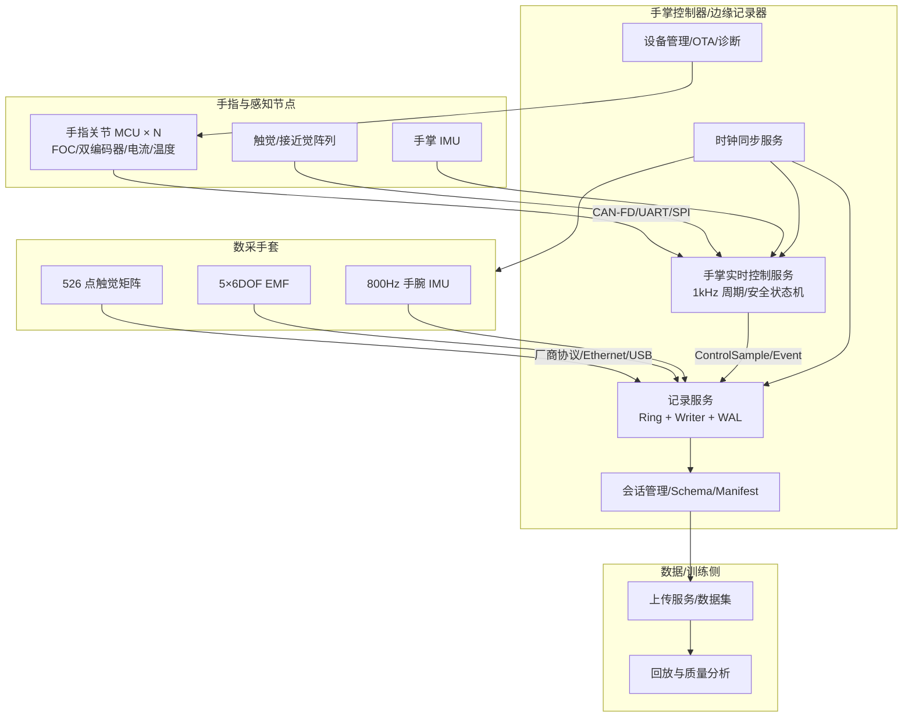
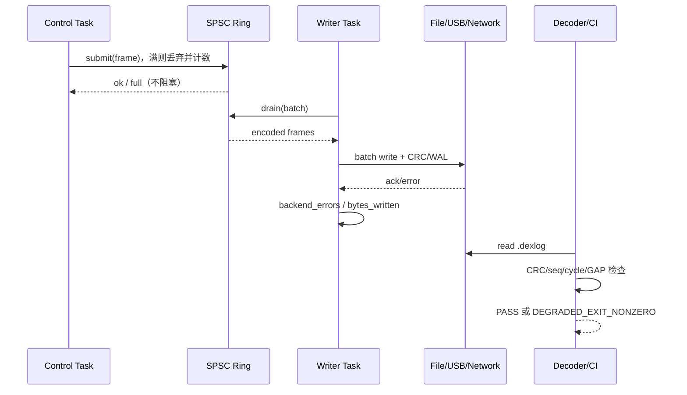
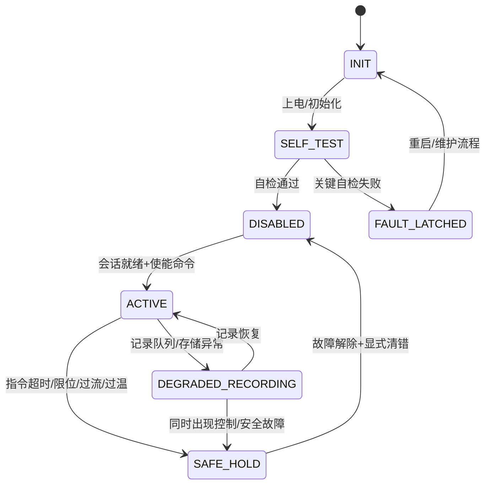

# 02 · 系统软件架构

## 1. 分层视图



## 2. 硬件职责候选划分

> 真实方案必须以舞肌现有硬件为准。下表是候选架构，不代表已知内部实现。

| 节点 | 主要职责 | 不建议承担 |
|---|---|---|
| 手指关节 MCU | FOC、编码器采集、电流采样、PWM、关节级过流/过温保护、本地诊断 | 文件系统、训练数据序列化、复杂上传 |
| 手掌控制器 MCU | 20 关节总线调度、目标插值、整手安全、控制快照、与边缘侧通信 | 重压缩、数据库、大规模 CSV/MCAP 转换 |
| 边缘记录器 MPU/上位机 | 文件系统、MCAP/rosbag2、压缩、网络上传、手套/相机/多模态汇聚、时间同步主节点 | 直接替代关节硬实时保护 |
| 数采手套采集板 | 触觉矩阵扫描、EMF/IMU 采集、预处理、低延迟数据上报 | 灵巧手闭环安全逻辑 |
| 云/数据平台 | 会话管理、数据质量、版本追溯、训练集生成 | 毫秒级实时控制 |

如果手掌控制器本身是高性能 MCU + 外部 Flash，也可以在 MCU 上完成二进制落盘；但仍应保持“控制生产者”和“记录消费者”的任务/队列隔离。

## 3. 控制任务与优先级

| 执行上下文 | 优先级建议 | 周期/触发 | 工作内容 | 时间约束 |
|---|---:|---|---|---|
| 电机 ADC/PWM ISR | 最高 | 10–20 kHz 或硬件周期 | 电流环、编码器采样、硬件保护 | 微秒级，尽量短 |
| 关节通信/控制任务 | 高 | 1 kHz | 关节状态交换、位置/速度环、安全检查、记录入队 | 必须早于下一个控制周期 |
| 手套/传感器采集任务 | 中高 | 120/800 Hz 或数据就绪 | 触觉/EMF/IMU 解析、时间戳、校验 | 低抖动，不阻塞控制 |
| 记录 writer 任务 | 中低 | 批量/唤醒 | ring drain、编码补充、写文件/USB/网络 | 允许突发延迟，由队列吸收 |
| 诊断/OTA/上传任务 | 低 | 事件/后台 | UDS、日志打包、固件升级、断点续传 | 不得抢占关键控制与保护 |
| LED/CLI/管理任务 | 最低 | 非实时 | 状态灯、命令行、配置界面 | 可被抢占 |

设计要点：

- ISR 中避免浮点重计算、字符串格式化、`malloc`、阻塞总线重试和文件 I/O；
- 控制任务使用静态内存、固定长度帧和有限循环；
- 记录入队是一次有界 `memcpy` + 原子索引更新；
- writer 批量 drain，减少系统调用和存储擦写次数；
- 关中断/临界区窗口只覆盖队列索引更新或硬件寄存器原子操作。

## 4. 控制环数据流

```text
timer tick
  │
  ├─ 1. 锁存本地采样时间 t_local
  ├─ 2. 从关节节点/本地采样获得 JointSample[20]
  ├─ 3. 通信校验：CRC、超时、通道有效性、总线错误计数
  ├─ 4. 安全评估：指令超时/限位/过流/过温/传感器/deadline
  ├─ 5. 控制律：目标插值 → P/PID/前馈/力矩限幅 → Command[20]
  ├─ 6. 下发关节指令；记录 apply 返回码
  ├─ 7. 测量控制路径耗时，更新 max/avg/deadline miss
  ├─ 8. 组装 DexControlSample：目标/实际/电流/安全/耗时/drop 计数
  ├─ 9. recorder_submit_control()：SPSC ring 非阻塞入队
  └─10. 下个周期
```

参考实现对应：

- `dex_control_loop_step()`：步骤 1–9 的主机可编译骨架；
- `dex_safety_evaluate()`：当前周期安全检查；
- `dex_recorder_submit_control()`：二进制编码和非阻塞入队；
- `dex_recorder_drain()`：消费者写出。

## 5. 记录数据流



### 5.1 队列容量规划输入

队列槽位数不能只靠“感觉够大”，至少要测量：

- 生产者帧率和最大帧长；
- writer 单次服务时间的平均值、P99、最坏值；
- 存储/USB/网络的最大卡顿时间；
- 允许占用的 RAM；
- 过载时允许丢弃的数据优先级。

简化公式：

```text
capacity_slots ≥ producer_rate × max_writer_stall_s × safety_factor
```

同时受 RAM 上限约束。若容量无法覆盖最坏卡顿，就必须定义降级策略，例如先丢高频调试字段、保留安全事件和低频状态，而不是假装队列无限。

### 5.2 数据优先级建议

| 优先级 | 数据 | 过载策略 |
|---|---|---|
| P0 | 安全事件、故障码、模式切换、会话起止、GAP | 尽量保留；使用独立小队列或高优先级通道 |
| P1 | 1kHz 控制快照、关节目标/实际/电流 | 队列满时可丢帧，但必须计数并暴露周期空洞 |
| P2 | 触觉/EMF/IMU 高频流 | 可降采样、增量编码或切换到独立通道 |
| P3 | 原始总线 trace、调试变量、波形 | 仅调试会话开启，过载最先丢弃 |

当前参考原型使用单一 ring，目的是让核心机制易读；产品化时建议拆成 P0 事件队列和 P1/P2 数据流队列，避免高频调试数据挤掉故障事件。

## 6. 时钟同步架构

### 6.1 时间戳原则

- 传感器采样时刻使用本地硬件定时器/输入捕获打时间戳；
- 控制环使用本地单调时钟做 deadline 和周期测量；
- 主机时间只用于会话关联和离线对齐，不参与硬实时控制；
- 同步服务保存原始同步样本、偏移、漂移和同步质量。

### 6.2 候选方案

| 方案 | 适用场景 | 优点 | 注意点 |
|---|---|---|---|
| 主节点周期广播 sync | 手掌 MCU + 手指节点 | 简单、确定、适合短距离 CAN-FD/UART | 要测量帧传输和从节点捕获延迟 |
| PPS/硬同步线 | 手、手套、相机、记录器 | 抖动小、对齐精度高 | 需要硬件连线和输入捕获 |
| IEEE 1588/PTP | Ethernet 边缘设备 | 生态成熟，适合多设备 | 对 MCU/PHY 和网络拓扑有要求 |
| 上位机软件时间对齐 | 低速率调试 | 易实现 | 抖动大，不能作为高精度唯一依据 |

参考代码中的 `DexClockSync` 只表达 offset + drift 的数据模型，不能替代真实同步协议验证。

## 7. 安全状态机建议



注意：“安全保持”的具体输出取决于关节结构。自锁直驱关节、绳驱关节和带传动关节在断电后的状态不同；候选策略包括零力、保持当前位置、限速回安全位或机械制动，必须由硬件和功能安全分析决定。

## 8. MCU 移植层

核心代码不直接调用 HAL，需要移植者提供：

```c
typedef struct {
    uint64_t (*now_ns)(void *user_ctx);
    int (*read_joints)(DexJointSample *joints, uint8_t joint_count, void *user_ctx);
    int (*apply_command)(const DexControlCommand *command, void *user_ctx);
    void *user_ctx;
} DexHandPlatform;
```

产品移植时还应补齐：

- 定时器/GPIO/看门狗；
- CAN-FD/SPI/UART 收发与 DMA；
- 关节模组协议编解码；
- Flash/EEPROM 参数存储；
- 记录 writer：`dex_recorder_drain(recorder, uart_or_spi_flash_writer, ctx, batch)`；
- 临界区版 SPSC ring（若不使用 C11 atomics）；
- OTA A/B 分区、版本读取和回滚；
- 错误码、DTC/UDS 诊断和产线标定。

详见 [`../firmware/port/stm32/README.md`](../firmware/port/stm32/README.md)。

## 9. 产品化前必须补的验证

1. **目标板 WCET**：定时器入口/出口打点 + GPIO 翻转 + 示波器/逻辑分析仪，覆盖最坏分支、关中断、总线错误和 cache 冷热启动。
2. **总线负载**：用真实 CAN-FD/USB/Ethernet 抓包验证峰值负载、错误帧、仲裁/重传和延迟分布。
3. **存储抖动**：模拟 eMMC/SD/Flash 擦写延迟、文件系统满、坏块和异常掉电。
4. **时间同步**：用逻辑分析仪或共同 GPIO 事件测量手、手套、IMU 和上位机时间偏差分布。
5. **故障注入**：传感器 CRC 错、电机过流、过温、通信超时、记录队列满、writer 断开、时钟失步、升级中断电。
6. **长时间稳定性**：连续抓取/遥操作/记录，观察内存、队列水位、丢帧、温度、存储增长和文件恢复。
7. **数据可用性**：从真实会话转换到训练格式，检查时间对齐、单位、坐标系、缺失区间和标签完整性。
